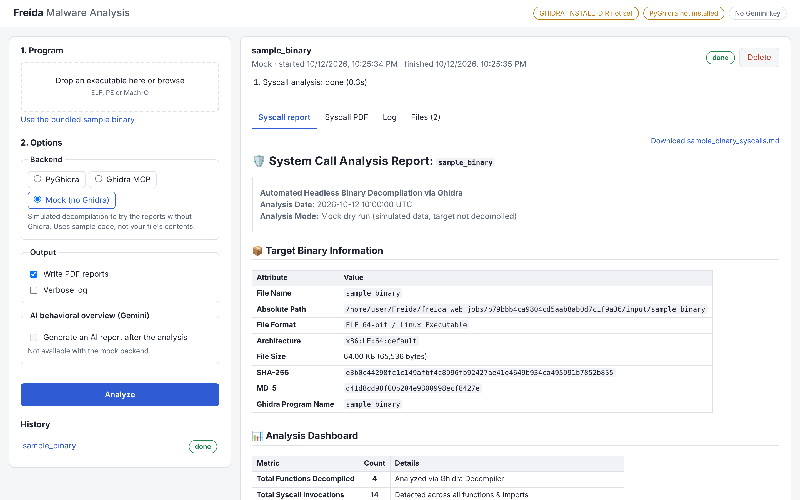
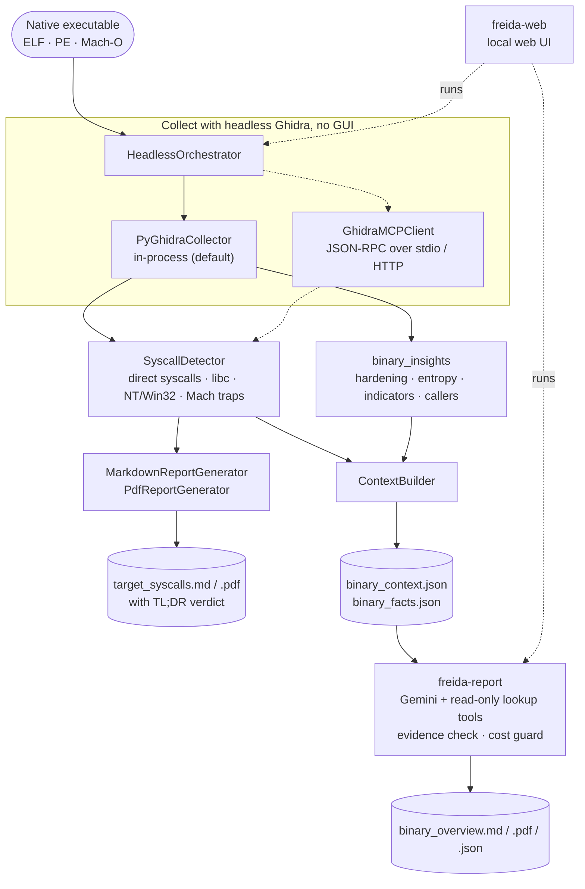
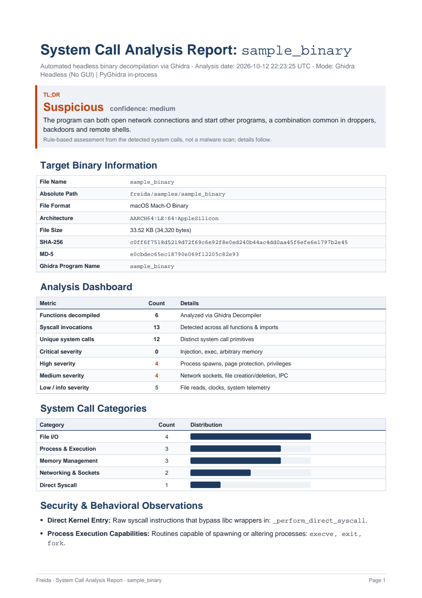

<div align="center">

# 🛡️ Freida

**Static malware triage for native executables.**<br>
Freida decompiles ELF, PE and Mach-O binaries with headless Ghidra, finds every system call, and turns the result into a verdict, printable reports and an evidence-checked AI behavioral overview.

[](https://github.com/luketegel/Freida/actions/workflows/ci.yml)


[](LICENSE)



</div>

---

## Contents

- [Why Freida](#why-freida)
- [Highlights](#highlights)
- [Quickstart](#quickstart)
- [How it works](#how-it-works)
- [Example output](#example-output)
- [Installation](#installation)
- [Usage](#usage)
- [Project structure](#project-structure)
- [Testing](#testing)
- [Security and privacy](#security-and-privacy)
- [License](#license)

## Why Freida

Deciding whether an unknown binary is dangerous usually means opening a disassembler and reading code by hand. What a program *can do* to a machine shows up in its system calls: opening files, starting processes, opening sockets, changing memory protection, writing into other processes. Freida automates that first pass:

1. **Decompile without a GUI.** Ghidra runs headless, in-process through PyGhidra (or through a Ghidra MCP server).
2. **Find every system call.** That covers raw syscall instructions, libc wrappers, Windows NT/Win32 APIs and macOS Mach traps, each tied to the function and exact call address it came from.
3. **Explain it.** Markdown and PDF reports open with a rule-based **TL;DR verdict**. An optional Gemini agent writes a **Behavioral Overview** and must cite its evidence, and Freida checks every cited function and address against the analysis facts.
4. **Stay in control of cost and data.** Before an AI run, Freida estimates its cost and enforces a hard spending cap. Local file paths are stripped from the AI prompt, and the web UI only listens on `localhost`.

## Highlights

- **Headless Ghidra, two backends.** PyGhidra in-process by default, or a Ghidra MCP server (JSON-RPC 2.0 over `stdio` or HTTP) with `--backend mcp`, `--mcp-cmd` or `--server-url`.
- **Cross-platform detection:**
  - **Linux:** ELF 32/64-bit.
  - **Windows:** PE (Win32 / x64), including `Nt*` / `Zw*` native calls.
  - **macOS:** Mach-O 64-bit and Universal binaries, including Mach traps.
  - Java `.class` / `.jar` files are rejected with an error.
- **Exact call sites.** With PyGhidra, each API call is tied to the address of its call instruction from Ghidra's own call references.
- **Syscall number resolution.** `syscall(59)` becomes `execve`, and direct `syscall` / `sysenter` / `int 0x80` / `svc #0` instructions are detected, including Ghidra's decompiled forms such as `CallSupervisor(0)`.
- **Reports people can share.**
  - The Markdown report has a dashboard, category bars, severity levels, a callsite inventory and decompiled evidence.
  - The PDF opens with a TL;DR verdict (*Malicious*, *Suspicious*, *Needs Review*, *Likely Benign* or *Unknown*) and lays out colored severities, drawn bars and paginated tables.
- **Model-ready context.** `binary_context.json` is a capped, relevance-ranked summary sized for a context window. `binary_facts.json` holds everything else, including:
  - hardening flags
  - memory-map entropy
  - indicators (URLs, IPs, paths, registry keys)
  - strings and globals with cross-references
  - data types
- **AI Behavioral Overview.** `freida-report` lets Gemini make up to 3 read-only lookups over the facts file. It prints the estimated cost before the run and the actual cost after, and `--max-cost` sets a hard ceiling.
- **Local web UI.** `freida-web` covers the whole flow in the browser: upload a binary, follow the live log, then read and download every report.

## Quickstart

**Try it in a minute, no Ghidra needed.** The mock backend runs the reporting pipeline on built-in sample code:

```bash
git clone https://github.com/luketegel/Freida.git
cd Freida
python3 -m venv .venv
source .venv/bin/activate
pip install -e .
freida freida/samples/sample_binary --mock-dry-run
```

This writes `sample_binary_syscalls.md` and `sample_binary_syscalls.pdf`. To do the same in the browser, run `freida-web --open`, choose **Mock (no Ghidra)** and click **Use the bundled sample binary**.

**Real analysis with Ghidra:**

```bash
pip install -e '.[ghidra]'
export GHIDRA_INSTALL_DIR=/path/to/ghidra_12.1.4_PUBLIC
freida /path/to/target_binary
```

**Add the AI Behavioral Overview** ([full guide](docs/ai-report.md)):

```bash
export GEMINI_API_KEY="AIza...your key..."
freida-report --dry-run
freida-report
```

## How it works



## Example output

[`examples/`](examples/) holds the report for the bundled sample program, built from a real Ghidra 12.1.4 analysis on Apple Silicon. It is available as [Markdown](examples/sample_binary_syscalls.md) and [PDF](examples/sample_binary_syscalls.pdf). Every report contains:

1. **Target metadata:** SHA-256 / MD5, size, file format and architecture.
2. **Analysis dashboard:** decompiled functions, detected system calls, and counts by severity.
3. **Category breakdown:** distribution across File I/O, Process & Execution, Networking, Memory Management and Security.
4. **Security and behavioral observations:** flags such as shell spawns, RWX page changes and remote socket connections.
5. **System call inventory:** every call site with function, call address, line, detection type, arguments and severity.
6. **Decompiled evidence:** code snippets around each call, plus the decompiled function body.

<p align="center">
  
</p>

The PDF's TL;DR verdict is rule-based on the detected system calls, not a malware scan. For example, writing into another process and starting a thread there is *Malicious*, and network access plus starting programs is *Suspicious*. The AI overview gives a model's judgement on top.

## Installation

### Requirements

- Python 3.10+
- [Ghidra](https://ghidra-sre.org) 12.1.4+ (set `GHIDRA_INSTALL_DIR`)
- A JDK supported by your Ghidra release (Ghidra 12.x requires JDK 21)
- [PyGhidra](https://pypi.org/project/pyghidra/) for the default backend. It is installed by the `ghidra` extra, or you can install the wheel Ghidra bundles under `Ghidra/Features/PyGhidra/pypkg/dist`.
- [uv](https://docs.astral.sh/uv/) (optional, for launching a Ghidra MCP server with `uvx`)

```bash
git clone https://github.com/luketegel/Freida.git
cd Freida
python3 -m pip install -e '.[ghidra]'
```

This registers three commands: `freida` (analysis), `freida-report` (AI overview) and `freida-web` (web UI). The original `ghidra-syscall-analyzer` command remains as an alias of `freida`.

> **Upgrading from `ghidra-syscall-analyzer`?** The package was renamed to `freida`. Reinstall once with `pip uninstall -y ghidra-syscall-analyzer && pip install -e '.[ghidra]'`.

### macOS (Apple Silicon)

- **Do not use Apple's built-in Python** (`/usr/bin/python3`). Its code signing blocks the JVM's JIT compiler, and `pyghidra.start()` crashes with `SIGBUS` in `CodeHeap::allocate`. Use a uv-managed or Homebrew Python instead:
  ```bash
  uv venv --python 3.12 --python-preference only-managed .venv
  source .venv/bin/activate
  ```
- **Homebrew Ghidra** (`brew install ghidra`) lives under `libexec`, and needs JDK 21 even if another Java is your default:
  ```bash
  export GHIDRA_INSTALL_DIR="$(brew --prefix ghidra)/libexec"
  export JAVA_HOME="$(brew --prefix openjdk@21)/libexec/openjdk.jdk/Contents/Home"
  uv pip install "$GHIDRA_INSTALL_DIR"/Ghidra/Features/PyGhidra/pypkg/dist/pyghidra-*.whl
  uv pip install -e .
  python -c "import pyghidra; pyghidra.start(); print('ok')"
  ```

## Usage

### Command line: `freida`

Analyze a binary, writing the Markdown and PDF reports and the model context bundle:

```bash
export GHIDRA_INSTALL_DIR=/path/to/ghidra_12.1.4_PUBLIC
freida /path/to/target_binary -o report.md --context-out context.json --facts-out facts.json
```

This writes `report.md` and `report.pdf`. The PDF goes next to the Markdown file with a `.pdf` suffix; change its path with `--pdf-out`, or skip it with `--no-pdf`. Without installing the package, `python3 analyze_syscalls.py` takes the same arguments.

**Headless Ghidra MCP via `uvx`:**

```bash
freida /path/to/target_binary \
    --mcp-cmd "uvx --python 3.13 --from 'ghidra-mcp[headless] @ git+https://github.com/LaurieWired/GhidraMCP' ghidra-mcp --headless --binary {binary}" \
    -o target_syscalls.md
```

**An already running Ghidra MCP server:**

```bash
freida /path/to/target_binary --server-url http://127.0.0.1:8081 -o target_syscalls.md
```

**Mock dry run.** This tests the pipeline and report formatting without Ghidra:

```bash
freida freida/samples/sample_binary --mock-dry-run -o sample_binary_syscalls.md
```

| Flag | Description |
| :--- | :--- |
| `target` | Path to the executable (ELF, PE, Mach-O). |
| `-b, --binary` | Explicit flag to specify the target path. |
| `-o, --output` | Output Markdown report file path (default: `<target>_syscalls.md`). |
| `--pdf-out` | Output PDF report path (default: the Markdown path with a `.pdf` suffix, e.g. `<target>_syscalls.pdf`). |
| `--no-pdf` | Do not write the PDF report. |
| `--context-out` | Output model context JSON path (default: `binary_context.json`). |
| `--facts-out` | Output full, uncapped facts JSON path (default: `binary_facts.json`). |
| `--backend` | `pyghidra` (default) or `mcp` (implied by `--mcp-cmd` / `--server-url`). |
| `--mcp-cmd` | Custom command to spawn a headless Ghidra MCP server (`{binary}` is replaced with the target path). |
| `--server-url` | URL of a running Ghidra MCP server (e.g. `http://127.0.0.1:8081`). |
| `--ghidra-dir` | Path to Ghidra root directory (overrides `GHIDRA_INSTALL_DIR`). |
| `--project-dir` | Optional directory to persist the Ghidra project across runs. |
| `--extension-jar` | Path to `GhidraMCP.jar` if not pre-installed in Ghidra. |
| `--timeout` | Timeout in seconds for each MCP request (default: `120.0s`). |
| `--max-functions` | Maximum functions to collect with the PyGhidra backend (default: all). |
| `--decompile-timeout` | Per-function decompilation timeout for the PyGhidra backend (default: `60`). |
| `--mock-dry-run` | Runs simulated decompilation to validate report generation. |
| `-v, --verbose` | Enables verbose debug logging. |

Every real run also writes `binary_context.json` and `binary_facts.json` for AI models. The [model context reference](docs/model-context.md) describes every key.

### Web UI: `freida-web`

`freida-web` starts a small web server on your machine with a page where you upload a program, pick the options, and read the results, no command line needed.

```bash
export GHIDRA_INSTALL_DIR=/path/to/ghidra_12.1.4_PUBLIC
freida-web --open
```

It prints `Freida web UI running at http://localhost:8765/`, and `--open` opens it in your browser. Without installing, run `python -m freida.webui.server`. Press `Ctrl+C` to stop.

In the page:

1. **Program:** drop an executable (ELF, PE, Mach-O) on the upload box, or use the bundled sample binary.
2. **Options:**
   - The backend: PyGhidra; Ghidra MCP with a launch command or server URL; or Mock, to try the reports without Ghidra.
   - Ghidra directory, function limit and timeouts, PDF output and verbose log.
   - The optional **AI behavioral overview**: model, thinking level, tool-call budget, cost limit, a cost-only dry run, and a Gemini API key that is used for that run only and never saved.
3. **Analyze:** the run's live log is shown while it works. When it finishes, the syscall report and AI overview are rendered, the PDFs open inline, and every output file (Markdown, PDF, context and facts JSON) can be downloaded.

The header shows whether Ghidra, PyGhidra and a Gemini key were found. Each upload is a job stored in `./freida_web_jobs/<id>/` (`input/`, `output/`, `log.txt`). Jobs are listed under **History** and kept across restarts until you delete them. Jobs run one at a time, each in its own process.

| Option | Description |
| :--- | :--- |
| `--host` | Interface to listen on (default `127.0.0.1`, reachable only from this machine). |
| `--port` | Port (default `8765`; `0` picks a free one). |
| `--workdir` | Folder for uploads and reports (default `./freida_web_jobs`). |
| `--max-upload-mb` | Largest accepted upload (default `200`). |
| `--open` | Open the UI in the default browser. |
| `-v, --verbose` | Log every request. |

### AI report: `freida-report`

`freida-report` sends the context to Gemini, lets the model make up to 3 read-only lookups over the facts file, and writes `binary_overview.md`, `.pdf` and `.json`. It prints the estimated cost before the run and the actual cost after, and refuses runs whose worst case exceeds `--max-cost` (default $1.00). With the default model, the bundled sample costs about $0.035–$0.12 per run.

The **[AI report guide](docs/ai-report.md)** covers the rest:
- API key setup (including the macOS Keychain)
- the cost table and what to do when the cost guard stops a run
- how to see which lookups the model made
- every option, and troubleshooting

## Project structure

```text
Freida/
├── freida/                     The Python package
│   ├── cli.py                  `freida`: analysis → reports + model context
│   ├── orchestrator.py         Runs a backend and turns its output into findings and facts
│   ├── pyghidra_collector.py   Default backend: in-process headless Ghidra via PyGhidra
│   ├── mcp_client.py           Optional backend: Ghidra MCP server (JSON-RPC over stdio / HTTP)
│   ├── syscall_detector.py     Detection rules: direct syscalls, libc, NT/Win32, Mach traps
│   ├── binary_insights.py      Hardening, entropy, indicators, callers, origins
│   ├── report_generator.py     Markdown report
│   ├── pdf_report.py           PDF reports with TL;DR verdicts
│   ├── context_builder.py      binary_context.json (capped) and binary_facts.json (full)
│   ├── report_agent.py         `freida-report`: Gemini Behavioral Overview with cost guard
│   ├── agent_tools.py          Read-only lookup tools the model can call over the facts file
│   ├── gemini_client.py        Minimal Gemini REST client with usage and cost accounting
│   ├── webui/                  `freida-web`: local web server and single-page UI
│   └── samples/                Sample program (C source and a macOS arm64 build)
├── tests/                      Unit tests and a real Ghidra 12.1.4 capture used as a fixture
├── examples/                   Example reports for the bundled sample
├── docs/                       AI report guide, model context reference, screenshots
└── analyze_syscalls.py         Runs the CLI from a checkout without installing
```

## Testing

```bash
python3 -m pip install -e '.[dev]'
ruff check .
python3 -m unittest discover -s tests
```

The suite runs without Ghidra or network access. The Gemini API is replaced by a scripted transport, and PyGhidra by fakes and a recorded Ghidra 12.1.4 capture. The live Ghidra integration test runs only when `GHIDRA_INSTALL_DIR` is set (it compiles `freida/samples/sample_binary.c` with `gcc`). CI runs lint and tests on Python 3.10–3.13 for every push.

## Security and privacy

- **Web UI:** the server runs the analyzer on whatever is uploaded, and the MCP launch command field runs a command on your machine, so keep it on `127.0.0.1`. It has these protections:
  - It rejects requests addressed to other host names (DNS rebinding) and cross-site form posts.
  - Reports are rendered escaped, so strings from a hostile binary can't run script in the page.

  Set `GEMINI_API_KEY` before starting the server to skip entering the key in the page.
- **AI data use:** on Gemini's free tier, Google may use prompts and responses to improve its products. On the paid tier (billing enabled) it does not, so use a billing-enabled key for proprietary or sensitive binaries. Local file paths are stripped from the prompt.
- **Static only:** Freida never executes the target. Its verdicts are triage aids, not a replacement for a malware scan or a full reverse-engineering review.

## License

[Apache-2.0](LICENSE)
